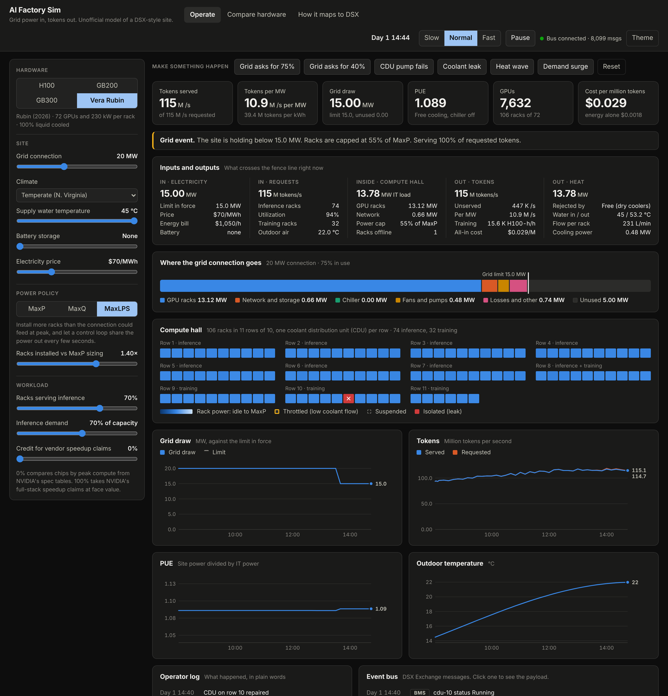
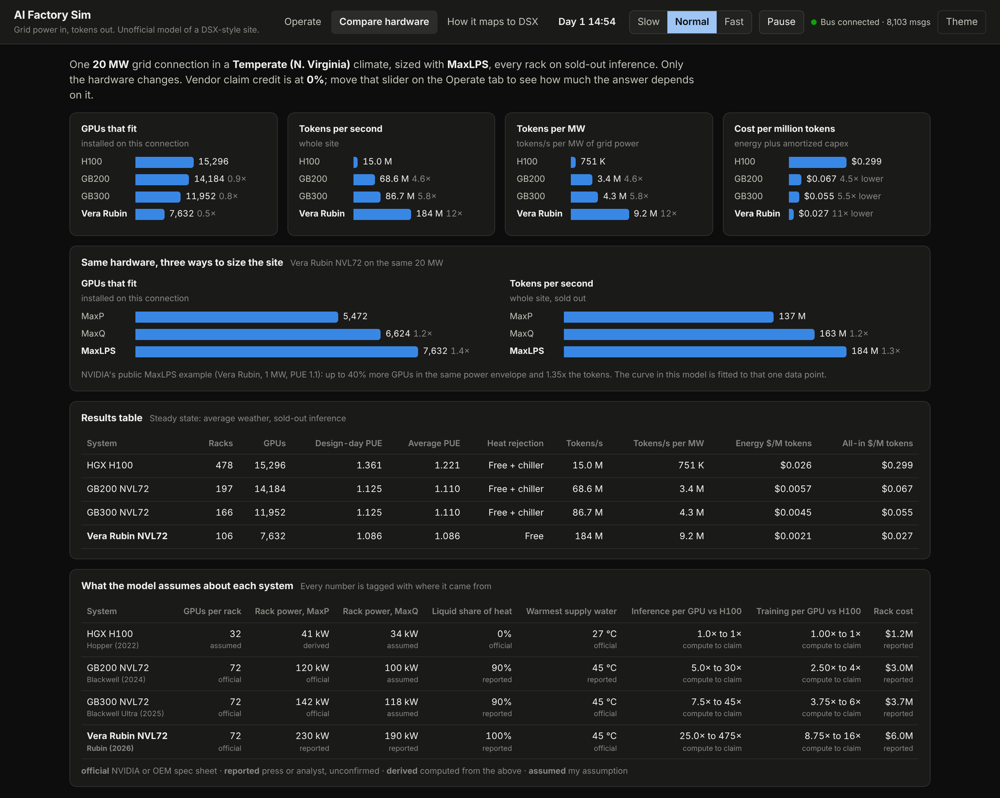

# AI Factory Sim

A small simulator of an AI factory: a grid connection goes in, tokens and heat come
out, and you control what sits in between. It is built to make NVIDIA's DSX
architecture easy to poke at. Change the hardware, the cooling water temperature or
the power policy and watch tokens per megawatt move. Trip a grid event and watch the
site respond.

Unofficial. Not affiliated with or endorsed by NVIDIA. The numbers are a teaching
model, not a design tool.



The Compare tab puts four NVIDIA systems on the same grid connection:



## Run it

```bash
docker compose up --build
```

| | |
|---|---|
| Dashboard | http://localhost:8000 |
| Event bus (MQTT on NATS) | mqtt://localhost:1883 |
| Prometheus | http://localhost:9090 |
| Raw metrics | http://localhost:8000/metrics |

Watch the bus while you click around:

```bash
pip install paho-mqtt
python scripts/listen.py 'BMS/v1/#'      # facility telemetry
python scripts/listen.py 'flex/v1/#'     # grid events
```

Without Docker: `pip install -e ".[dev]" && factorysim`. The dashboard works on its
own; with no broker configured the bus runs dry and shows messages in the UI only.

## What it models

```
grid power ─► distribution losses ─► IT load (GPU racks, network, storage)
                                        │
                requests ─► utilization ┴─► tokens (inference), GPU-hours (training)
                                        │
                                      heat ─► coolant loop ─► dry coolers / chiller ─► outdoors
```

Three controls act on that chain, and they are the heart of DSX:

- **Sizing policy.** MaxP sizes the site so every rack can peak at once. MaxQ holds
  every GPU at its efficient point. MaxLPS installs more racks than the connection
  can feed at peak and lets a control loop share the power.
- **Power control.** A loop caps rack power every tick to keep the site inside its
  envelope, standing in for NVIDIA's Dynamic Power Software.
- **Grid response.** A grid services provider sets a load target; the site ramps
  down, reports its state, and suspends racks if capping is not enough.

## Things to try

1. **Hardware.** On the Compare tab, the same 10 MW carries about 7,600 H100s or
   3,800 Vera Rubin GPUs. The Rubin site makes roughly 12× the tokens on chip compute
   alone. Slide "credit for vendor claims" to 100% and the gap matches the keynotes.
2. **MaxLPS.** Switch MaxP to MaxLPS: 39% more GPUs, 35% more tokens, each GPU a few
   percent slower. This reproduces NVIDIA's one public example.
3. **Warm water.** Pick the hot climate and drag supply water from 45 °C to 25 °C.
   The chiller comes on, PUE rises, and fewer racks fit.
4. **Grid event.** "Grid asks for 75%" is absorbed by power capping. "Grid asks for
   40%" is not: a breach alert fires and racks are suspended, training first.
5. **Leak.** Three messages cross the bus from two publishers: the BMS reports the
   leak, IT requests isolation, the BMS confirms.

## How it maps to DSX

| DSX piece | What NVIDIA ships | Here |
|---|---|---|
| Reference Design | validated compute, power and cooling designs per generation | hardware catalog and sizing math |
| MaxLPS | 45 °C cooling, Dynamic Power Software, perf-per-watt techniques | power policy switch, control loop, cooling model |
| Exchange | open-source IT/OT event bus (NATS, MQTT, AsyncAPI schemas) | real NATS broker; messages follow the BMS Event Bus schema |
| Flex | grid load targets, power state, breach and enforcement events | all four event types as signed CloudEvents |
| OS | scheduling, health, lifecycle (KAI Scheduler, NVSentinel, GPU Operator...) | only `/metrics` in DCGM exporter naming |
| Sim | Omniverse DSX Blueprint, DSX Air | this app is a toy version of the idea |

## NVIDIA open source it speaks

**DSX Exchange, BMS Event Bus.** Topics and payloads follow the published schema:

```
BMS/v1/PUB/Value/Rack/RackPower/site1/row01/R01-01      {"value": 159.6, "timestamp": 1794268800000, "quality": 1}
BMS/v1/PUB/Metadata/Rack/RackPower/site1/row01/R01-01   {"objectType": "Rack", "pointType": "RackPower", "engUnit": "kW", ...}
BMS/v1/FACTORYSIM/Value/CDU/LiquidTemperatureSpRequest/site1/row01/cdu-01
```

Racks, CDUs, power meters, the chiller, the battery and heartbeats are published on
change and every 100 seconds, with retained metadata, as the integration guide asks.

**DSX Flex.** `grid.loadtarget.set.v1`, `grid.powerstate.status.v1`,
`grid.powerbreach.alert.v1` and `grid.powerbreach.enforcement.v1` are CloudEvents
1.0.2 with the documented source URIs, correlation IDs and payload fields. `data` is
a JWS signed with ES256, as the spec requires.

**DCGM.** `/metrics` uses `DCGM_FI_DEV_GPU_UTIL`, `DCGM_FI_DEV_POWER_USAGE`,
`DCGM_FI_DEV_POWER_MGMT_LIMIT` and `DCGM_FI_DEV_GPU_TEMP`, one series per rack.

**What I had to guess.** The Flex pages I could read list event types and payloads
but not MQTT topic names, the item shape inside `SetLoadTargetData.targets`, or the
status event names past `target_set` and `start_ramp_down`. Those are marked
`INFERRED` in `exchange.py`. Messages are built to the docs but have not been
validated against the AsyncAPI files in `dsx-ai-factory/dsx-exchange`. That is the
first item on the roadmap.

## Hardware catalog

| | GPUs per rack | Rack power (MaxP) | Cooling | Warmest supply water |
|---|---|---|---|---|
| HGX H100 | 32 (assumed) | 41 kW | air | 27 °C air inlet |
| GB200 NVL72 | 72 | 120 kW | ~90% liquid | 45 °C |
| GB300 NVL72 | 72 | 142 kW | ~90% liquid | 45 °C |
| Vera Rubin NVL72 | 72 | 230 kW (reported) | 100% liquid | 45 °C |

Every number in `src/factorysim/catalog.yaml` is tagged official, reported, derived
or assumed, and the Compare tab shows the tags. Edit the YAML to add a platform or
argue with an assumption. `docs/MODEL.md` has the equations and the three places the
model is checked against published data.

## Limits

Absolute tokens and dollars hang on one anchor (1,000 tokens/s per H100) and on press
estimates of rack prices, so read them as ratios. Vera Rubin's rack power is from
secondary sources. Latency, networking, scheduling and real workloads are not
modelled. See the end of `docs/MODEL.md`.

## Layout

```
src/factorysim/
  catalog.yaml    hardware, climates, facility constants, each with a basis tag
  engine.py       the model: sizing, power control, cooling, grid events, faults
  exchange.py     DSX Exchange publisher: BMS Event Bus and DSX Flex messages
  metrics.py      Prometheus endpoint with DCGM names
  server.py       FastAPI: REST, WebSocket, static dashboard
  static/         dashboard (plain HTML, CSS, JS; no build step)
deploy/           NATS and Prometheus config
tests/            model calibration, events, bus messages, API
```

## Roadmap

- Validate every message against the AsyncAPI schemas in `dsx-exchange`, and run
  against its real stack (auth callout, Agent Gateway) instead of bare NATS.
- Put a scheduler in the loop: KAI Scheduler on a kind cluster with fake GPU nodes,
  with Topograph supplying topology.
- An MCP server over the sim so an operations agent can query and act through the
  DSX Agent Gateway.
- Kyber-generation racks and 800 VDC power once numbers are public.

## Sources

- NVIDIA DSX documentation: https://docs.nvidia.com/dsx
- DSX MaxLPS overview: https://docs.nvidia.com/dsx/maxlps/overview
- DSX Exchange schemas: https://docs.nvidia.com/dsx-exchange/schema
- DSX Exchange BMS integration guide: https://docs.nvidia.com/dsx-exchange/bms-integration
- DSX Flex architecture: https://docs.nvidia.com/dsx/flex/architecture
- DSX Exchange repository: https://github.com/dsx-ai-factory/dsx-exchange
- NVIDIA DSX announcement, GTC Taipei 2026: https://nvidianews.nvidia.com/news/dsx-infrastructure-ai-factory
- GB300 NVL72 power and cooling figures (HPE, Lenovo, NVIDIA): https://gr1d.us/insights/gb300-nvl72-colocation-requirements
- NVL72 generation comparison: https://www.insidedeeptech.com/vera-rubin-nvl72-vs-gb300-vs-gb200-full-guide/
- Vera Rubin NVL72 rack power: https://hashrateindex.com/blog/nvidia-vera-rubin-nvl72-specs-breakdown/

## License

Apache 2.0.
